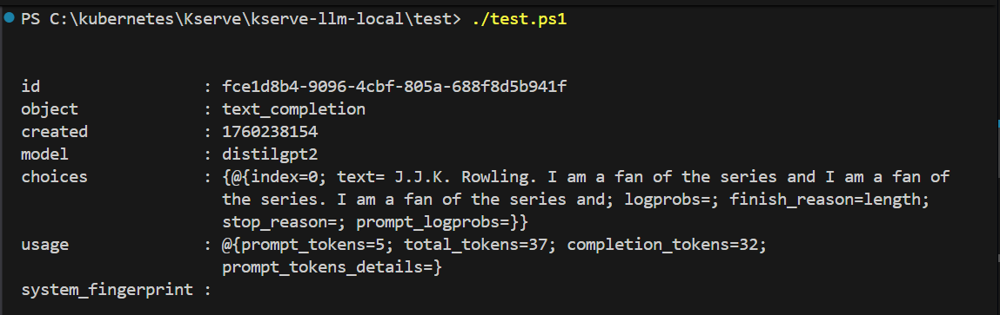

# KServe LLM (distilgpt2) — Local, Windows + kind

Spin up a local Kubernetes (kind) cluster on Windows, install cert‑manager, Istio, and KServe, then deploy **distilgpt2** from Hugging Face and call it using **OpenAI‑compatible** endpoints.

> **Tested on:** Windows 10/11 + PowerShell 7, Docker Desktop, kind, K8s v1.30+.

---

## Folder layout
```
kserve-llm-local/
├─ cert-manager/
│  └─ install-cert-manager.ps1
├─ istio/
│  └─ install-istio.ps1
├─ kserve/
│  ├─ install-kserve.ps1
│  ├─ patch-webhooks.ps1
│  └─ values-kserve.yaml
├─ models/
│  ├─ apply-model.ps1
│  └─ isvc-distilgpt2.yaml
├─ prereqs/
│  └─ kind-cluster.yaml
├─ run/
│  ├─ call-chat.ps1
│  └─ port-forward-istio.ps1
├─ test/
│  └─ test.ps1
├─ add-served-name.json
├─ isvc-distilgpt2.yaml        # (root copy, optional)
├─ openapi.json                 # dumped from the server
└─ README.md                    # this file
```

---

## Prerequisites
- **Docker Desktop** with at least **8 GB RAM** allocated (more is better).
- **PowerShell 7+** (pwsh).
- **kubectl**, **helm**, **kind** on PATH.
- Internet egress to `huggingface.co`.
- A Hugging Face access token exported to your session:
  ```powershell
  $env:HF_TOKEN = '<YOUR_HF_TOKEN>'
  ```

> Tip: If you previously created a secret named `hf-token` in the `default` namespace, the scripts will reuse it.

---

## Quick start
From the repo root:
```powershell
# 0) Create a local kind cluster
kind create cluster --config .\prereqs\kind-cluster.yaml

# 1) Install base components
./cert-manager/install-cert-manager.ps1
./istio/install-istio.ps1
./kserve/install-kserve.ps1
./kserve/patch-webhooks.ps1     # fixes local webhook svc DNS for kind

# 2) Deploy the model (creates/uses hf-token secret and InferenceService)
./models/apply-model.ps1

# 3) Wait until the service is Ready
kubectl -n default wait --for=condition=Ready inferenceservice/distilgpt2 --timeout=15m

# 4) Port-forward to the predictor Service (leave in its own terminal)
kubectl -n default port-forward svc/distilgpt2-predictor 8085:80

# 5) Call the OpenAI-compatible API
./run/call-chat.ps1
```

---

## What the scripts do
### `cert-manager/install-cert-manager.ps1`
Installs cert-manager CRDs and components. Waits for the pods to become ready.

### `istio/install-istio.ps1`
Installs Istio (istiod and ingressgateway) suitable for KServe. If you prefer, you can also port‑forward directly to the predictor Service and skip the gateway for local dev.

### `kserve/install-kserve.ps1`
Installs KServe via Helm, using `kserve/values-kserve.yaml` to enable the **HuggingFace Server** runtime and OpenAI endpoints.

### `kserve/patch-webhooks.ps1`
For kind clusters, patches KServe’s validating/mutating webhook svc names or addresses so admission webhooks resolve correctly.

### `models/apply-model.ps1`
- Creates (or reuses) the `hf-token` secret in `default` using `$env:HF_TOKEN`.
- Applies `models/isvc-distilgpt2.yaml`.
- Waits for the deployment rollout & InferenceService **Ready** condition.

### `run/port-forward-istio.ps1` (optional)
Port‑forwards the Istio ingressgateway locally (handy if you want to call through the gateway). For quick local dev, forwarding the **predictor Service** to `localhost:8085` is simpler.

### `run/call-chat.ps1`
Example PowerShell client that calls the **OpenAI endpoints** exposed by `huggingfaceserver`.

### `test/test.ps1`
Smoke tests (chat completion and related checks). Update/add tests as needed.

---

## The InferenceService
`models/isvc-distilgpt2.yaml` (summarized):
- Downloads **distilbert/distilgpt2** via the Storage Initializer.
- Runs `kserve/huggingfaceserver:v0.15.0` with args:
  - `--backend=huggingface`
  - `--task=text_generation`
  - `--model_name=distilbert/distilgpt2`
  - `--dtype=float32` (safer on CPU)
  - `--served-model-name=distilgpt2` (friendly, slash‑free name)
  - optionally `--http_port=8080`
- Exposes the **OpenAI‑compatible API** (you’ll see in logs: `OpenAI endpoints registered`).

> Why `--served-model-name`? Without it, the server may register the model as `distilbert/distilgpt2`. Using a simple name makes URLs and clients much easier.

---

## Verifying the deployment
After `apply-model.ps1` completes:
```powershell
# Should show predictor is Ready
kubectl -n default get isvc distilgpt2

# Predictor Service & endpoint should exist
kubectl -n default get svc distilgpt2-predictor -o wide
kubectl -n default get endpoints distilgpt2-predictor -o wide

# See model server logs (look for "OpenAI endpoints registered")
$pod = (kubectl -n default get pod -l "serving.kserve.io/inferenceservice=distilgpt2" -o json | ConvertFrom-Json).items[0].metadata.name
kubectl -n default logs $pod -c kserve-container --tail=200
```

If you need the OpenAPI spec exposed by the server:
```powershell
Invoke-RestMethod -Uri "http://localhost:8085/openapi.json" -Method Get |
  ConvertTo-Json -Depth 3 | Out-File -Encoding UTF8 .\openapi.json
```

---

## Calling the model (PowerShell)
### 1) List models
```powershell
Invoke-RestMethod -Uri "http://localhost:8085/v1/models" -Method Get
# Expect something like: { distilgpt2 }
```

### 2) OpenAI **completions** (recommended for GPT‑2 family)
The HuggingFace server exposes OpenAI endpoints under `/openai/...`.
```powershell
$req = @{
  model       = "distilgpt2"          # or the name you saw from /v1/models
  prompt      = "Hello, my name is"
  max_tokens  = 32
  temperature = 0.8
} | ConvertTo-Json

Invoke-RestMethod -Uri "http://localhost:8085/openai/v1/completions" `
  -Method Post -ContentType "application/json" -Body $req
```

### 3) OpenAI **chat** (requires a chat template)
Transformers ≥ **4.44** requires a chat template for chat endpoints. If your tokenizer doesn’t define one, either:
- Add a Jinja template to the model’s `generation_config.json` (key `chat_template`),
- or call **completions** instead of chat.

If you have a chat template, this payload works:
```powershell
$chat = @{
  model = "distilgpt2"
  messages = @(
    @{ role = "system"; content = "You are concise." },
    @{ role = "user";   content = "Say hello in one short sentence." }
  )
  max_tokens  = 32
  temperature = 0.7
} | ConvertTo-Json -Depth 5

Invoke-RestMethod -Uri "http://localhost:8085/openai/v1/chat/completions" `
  -Method Post -ContentType "application/json" -Body $chat
```

### 4) KServe protocol (not for this model)
`/v1/models/{model}:predict` expects the KFServing V1 payload (e.g., `instances`). For **HuggingfaceGenerativeModel** the server returns `Model ... does not support inference` on that route. Use the **OpenAI endpoints** above instead.


---

## Troubleshooting
**Port‑forward fails with "Only one usage of each socket address"**
- Another forward is holding `8085`. Find and kill it:
  ```powershell
  netstat -ano | findstr :8085
  Stop-Process -Id <PID>
  # or use a different local port, e.g. 18085: kubectl port-forward svc/distilgpt2-predictor 18085:80
  ```

**`Model with name X does not exist`**
- Check the registered names:
  ```powershell
  Invoke-RestMethod -Uri "http://localhost:8085/v1/models" -Method Get
  ```
- If you see `distilbert/distilgpt2`, either use that in your URL or set `--served-model-name=distilgpt2` in the ISVC and redeploy.

**`/v1/models/{name}:generate` returns 405/Not Allowed**
- Use OpenAI endpoints: `/openai/v1/completions` or `/openai/v1/chat/completions`.

**Chat endpoint returns 500 about chat template**
- Add a `chat_template` to `generation_config.json`, or stick to `/openai/v1/completions`.

**Storage initializer is stuck / slow**
- Check cluster egress to Hugging Face:
  ```powershell
  kubectl -n default run netcheck --rm -it --restart=Never --image=busybox:1.36 --command -- sh -c `
    'nslookup huggingface.co; echo; wget -q -O - https://huggingface.co/api/models/distilbert/distilgpt2 | head -c 200; echo'
  ```
- If DNS is OK but download is slow, wait for the first pull to complete. Subsequent pods reuse the cached model layer.

**Probe failures / `connection refused`**
- Wait for logs to show `Uvicorn running on http://0.0.0.0:8080` and `OpenAI endpoints registered`.
- Ensure you forward to the **predictor Service** or directly to the **Running** pod.

---

## Clean up
```powershell
kubectl -n default delete inferenceservice distilgpt2 --ignore-not-found
kubectl -n default delete deploy,svc,rs -l serving.kserve.io/inferenceservice=distilgpt2 --ignore-not-found
kind delete cluster
```

---

## Extending
- Swap to a different HF model by editing `models\isvc-distilgpt2.yaml` (`storageUri`, `--model_name`, `--served-model-name`).
- Tune resources in the same file (`requests/limits`).
- Add more tests under `test/` and wire them into CI.

---

## Support matrix
- **CPU only** by default (`--dtype=float32`).
- For GPU nodes, adjust image/args and add GPU limits/requests.

---

**Happy serving!**

